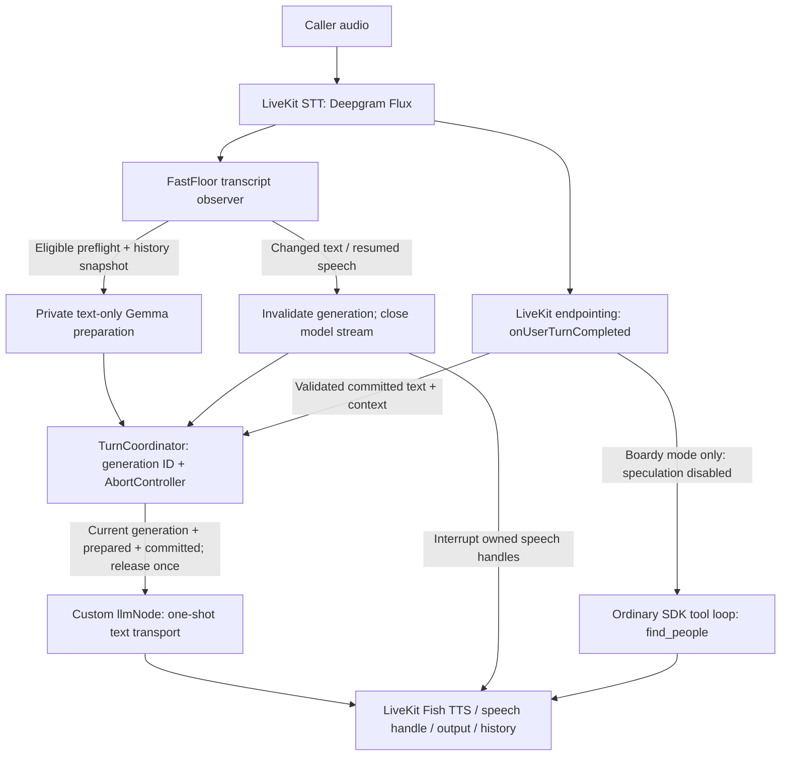

# FastFloor

Start thinking before the caller finishes. Speak only after commitment.

What: A working LiveKit voice-agent prototype that uses Deepgram Flux preflight signals to prepare LLM responses early, while a custom TurnCoordinator controls cancellation and release to TTS.

The hard problem: Preventing stale responses from speaking without losing valid conversation history when users correct themselves or interrupt.

Measured: Median commitment-to-first-SDK-playback dropped from 1,016 ms to 474 ms (53.4%), across 10 samples per arm. Both arms use full-response buffering; only speculative preparation differs.

Limitations: Exploratory SDK console measurement, not caller-audible latency or a comparison against an optimized streaming baseline. Rollback-specific tail latency remains unmeasured.

Next: Measure caller-audible onset, quantify rollback latency under corrections and interruptions, and compare against an optimized streaming agent.

## Architecture and ownership



- Speculative execution: preparation buffers a complete response privately, with
  no tools and no TTS. A preflight or final transcript alone never authorizes speech.
- Commit gating: `onUserTurnCompleted` validates the complete SDK message and
  conversation context. A matching candidate is reused; changed history or a
  validated multi-final turn triggers fresh preparation from the complete committed
  input. Ambiguous provenance fails closed. The output node checks message ID/text
  and claims released text once. There is no parallel `say()`/`generateReply()` path.
- Cancellation: the coordinator's generation ID rejects late results even if a
  producer ignores abort. Its existing AbortSignal closes the public model stream;
  invalidation also interrupts tracked SDK speech handles. Stream observers forward
  cancellation upstream even during a stalled read. Transmitted audio cannot be
  retracted.
- History correctness: accepted input and permission to reply are separate.
  Agents 1.9.4 can skip input persistence when a commit hook raises `StopResponse`.
  On these stopped paths, the adapter retains only provenance-validated committed
  input by SDK ID in agent/session history—not hypotheses or cancelled replies.
  Regressions inspect both histories and the next actual model request.
- Library versus custom: LiveKit owns STT transport, endpointing, reply scheduling,
  tool execution, TTS, output, interruption machinery, and normal history. FastFloor
  supplies candidate validity, commitment authorization, one-shot transport, targeted
  stopped-input recovery, and experimental timing instrumentation.

Core code: [coordinator](src/fastfloor/turn-coordinator.ts),
[adapter](src/fastfloor/livekit-flux-spike.ts), [mode selection](src/main.ts).
[ARCHITECTURE.md](ARCHITECTURE.md) records decisions and the historical experiments.

## Measured results—not caller-audible latency

Matched Baseline vs. FastFloor experiment, October 28, 2026. Metric: SDK user-turn
commitment → first associated SDK console-output playback event. Both arms run the
same implementation: Baseline starts preparation at commitment; FastFloor can
start at preflight. This compares non-speculative versus speculative execution,
not two versions of the codebase.

| Metric                            |     Baseline |  FastFloor |
| --------------------------------- | -----------: | ---------: |
| Median SDK playback latency (p50) | 1,016.374 ms | 474.035 ms |
| p95 SDK playback latency          | 1,778.332 ms | 997.356 ms |
| Speculative candidates reused     |            0 |          9 |
| Rollbacks                         |            0 |          2 |
| Pre-commit SDK playback events    |            0 |          0 |

FastFloor achieved a **53.4% lower median commitment-to-first-SDK-playback latency**
in this exploratory comparison.

Four fresh sessions in Baseline/FastFloor/FastFloor/Baseline order, five matched
requested texts per session, with 10 requested turns, commitments, and playback
samples per arm. Real hosted Deepgram Flux, Gemma, and Fish Audio ran through
LiveKit CLI console output. Both arms used Flux `deepgram/flux-general-en`
(`eager_eot_threshold: 0.5`), Gemma `google/gemma-4-31b-it`, Fish
`fishaudio/s2.1-pro`, identical prompt/voice, unchanged STT endpointing defaults,
disabled SDK preemption, and full-response buffering. Only custom preflight
preparation differed. This control is not the default streaming AssemblyAI agent.

Reuse counts speculative candidates actually claimed by the output node; rollbacks
count candidates invalidated before claim. Both arms had zero unattributed SDK
playback events. None of these counts establishes acoustic leakage safety or
semantically correct endpointing.

Limitations: freshly generated caller audio, not identical waveform replay; only
ten samples per arm; nearest-rank p95 is the maximum. Cold starts, provider/network
variation, response length, synchronous trace I/O, and a constrained one-CPU host
confound interpretation. The transport was CLI console audio, not a measured
remote listener. Caller-side audible onset remains null. No verified production
speedup or comparison against an optimized streaming baseline is claimed.

Evidence: [methodology](spikes/002-history-evaluation/REAL_AUDIO_VERIFICATION.md),
[per-turn comparison](spikes/002-history-evaluation/real-audio/measured-comparison.json),
[benchmark report](spikes/002-history-evaluation/real-audio/postfix-console-report.json).
Only the final measurement set supplies these results; archived diagnostics are
separate and excluded from the headline comparison.

## Boardy-inspired networking workload

`FASTFLOOR_BOARDY=1` enables a separate committed-only reference workload, not the
real Boardy service. [The local dataset](src/fastfloor/people.ts) contains 18 frozen,
fictional profiles with city, role, topic, offers, and seeking fields—no real
contacts. The model interprets preferences and corrections; the read-only
`find_people` tool validates/intersects city/role/topic filters, returns at most
five profiles, and explicitly reports no matches.

Verified interaction: a request for a robotics founder in Boston called
`find_people`, retrieved fictional Maya Chen (warehouse automation expertise;
seeking pilot customers), and naturally offered help drafting an introduction.
This live interaction is a developer-reported manual result. Separately,
[saved hosted-model evidence](spikes/002-history-evaluation/boardy-hosted-results.json)
shows New York → Boston correction, Leo Navarro → Maya Chen retrieval, and tool
history; its STT/TTS transports are fixtures, not microphone evidence.

All speculative preparation is disabled in this mode, even if an evaluation arm
is set. The SDK executes tools only after validated audio commitment. There are no
contact, send-introduction, scheduling, payment, or mutation capabilities. Offering
to draft text is not sending an introduction. Tool-enabled speculation is disabled.

## Setup and run

Use Node.js 24+ (the project uses native TypeScript stripping), pnpm 10.15.0 as in
CI, and the LiveKit CLI (audio benchmark captured with 2.19.2). A LiveKit Cloud
project with inference access is required for hosted audio/model runs; they can
incur charges. Install the CLI following the [official instructions](https://docs.livekit.io/intro/basics/cli/).

```sh
git clone --branch feat/fastfloor-livekit-integration-spike https://github.com/shehraan/fastFloor.git
cd fastFloor
pnpm install --frozen-lockfile
lk cloud auth
lk app env --write --destination .env.local
```

Alternatively copy `.env.example` to `.env.local` and configure it locally. Never
commit credentials. The agent loads `.env.local`; CLI audio-debugger subprocesses
also need project credentials (the benchmark runner uses `node --env-file`).
Start one mode at a time from a shell with other `FASTFLOOR_*` flags unset:

```sh
# Original LiveKit default: AssemblyAI / SDK turn detector / streaming model output
pnpm dev

# Matched baseline: Flux, preparation starts only after commitment
FASTFLOOR_EVAL_ARM=baseline pnpm dev --no-reload

# FastFloor: same matched pipeline, eligible preflight starts preparation
FASTFLOOR_EVAL_ARM=fastfloor pnpm dev --no-reload

# Fictional networking: Flux + ordinary committed SDK tool loop, no speculation
FASTFLOOR_BOARDY=1 pnpm dev --no-reload
```

Connect with microphone/headphones through [LiveKit Agent Console](https://docs.livekit.io/testing/agent-console/)
to agent `fastfloor` in the local dev deployment. Flux modes intentionally have no
greeting: speak first. `FASTFLOOR_REAL_LLM=1` is the existing real speculative mode;
`FASTFLOOR_FLUX_SPIKE=1` alone retains the original fake-response experiment.

## Reproduce tests and evidence

```sh
pnpm test
pnpm typecheck
pnpm lint
pnpm format:check
pnpm exec tsc --noEmit --skipLibCheck false

# Test files/runners are outside the project's ordinary tsconfig check
pnpm exec tsc --noEmit --target ES2022 --module ES2022 --moduleResolution bundler --allowImportingTsExtensions --erasableSyntaxOnly --strict --exactOptionalPropertyTypes --noUncheckedIndexedAccess --noImplicitOverride --skipLibCheck --esModuleInterop src/fastfloor/*.test.ts scripts/summarize-traces.ts spikes/002-history-evaluation/run-audio-debugger.ts

# Offline matched mechanics; fixtures replace provider transport and output device
FASTFLOOR_EVAL_OUTPUT=/tmp/ff-scripted.json pnpm eval:sdk
node scripts/summarize-traces.ts /tmp/ff-scripted.json > /tmp/ff-scripted-report.json

# Recompute saved real-provider audio reports; no inference calls
node scripts/summarize-traces.ts spikes/002-history-evaluation/real-audio/postfix-console/*.jsonl > /tmp/ff-saved-report.json
```

The suite has 65 executable tests: coordinator invariants, actual SDK session/hook
integration with controlled transports, cancellation/failure/history regressions,
reporting, and fictional search validation. Deterministic tests are not acoustic
measurements. [CI](.github/workflows/tests.yml) runs the offline suite, typecheck,
lint, and formatting; [semantic simulations](scenarios.yaml) run on merges to
`main`/manual dispatch with configured LiveKit repository secrets. Text simulations
bypass the audio commitment path and do not validate its gating/cancellation.

For fresh hosted audio, execute sessions 1–4 in separate invocations, using a new
output directory outside the repository (billable):

```sh
node --env-file=.env.local spikes/002-history-evaluation/run-audio-debugger.ts /tmp/ff-new-audio 1
# Repeat with final argument 2, then 3, then 4; do not overwrite an earlier capture.
node scripts/summarize-traces.ts /tmp/ff-new-audio/*.jsonl > /tmp/ff-new-audio/report.json
```

The runner refuses existing session traces/occupied port 8787 and checks shutdown.
[The evidence guide](spikes/002-history-evaluation/README.md) includes hosted-model
and networking harness commands; the [audio report](spikes/002-history-evaluation/REAL_AUDIO_VERIFICATION.md)
includes acoustic measurement procedures and failed room-simulation evidence.

## Tradeoffs and remaining limits

- Full-response buffering simplifies private, fail-closed preparation but delays
  non-reused replies and may waste generation. Measured first-delta → completion
  p50: 127 ms baseline / 140 ms FastFloor; not a streaming counterfactual.
- Exact transcript/history matching sacrifices reuse for correctness. The normalized
  STT API lacks a typed raw Flux resumed-turn/turn-ID contract; ambiguous event
  ordering cannot be repaired by guessing. No endpointing changes were added.
- Manual microphone testing succeeded overall, including corrections/interruptions.
  One isolated instance of missed speech after an agent response remains an
  unconfirmed intermittent observation—not a diagnosed bug or measured failure rate.
- Caller-side acoustic onset, residual interrupted audio, and production reliability
  remain unmeasured. Earlier room simulations captured zero conversational turns;
  their cause remains unresolved. Manual success does not supply missing metrics.
- Opt-in logs/traces contain transcripts and full model context, use synchronous I/O,
  and have no production redaction/retention policy. Use fictional inputs only; keep
  new captures outside Git. Trace-write failures are not isolated from the experiment.

See [the 60–90-second demo checklist and sharing steps](DEMO.md). This packaging
phase adds no runtime features, providers, speculative tools, or architecture changes.
